# 5v5

지인끼리 주말 롤 5대5 내전 날짜와 자리를 잡는 모바일 웹앱.

| 메인 (티켓 목록) | 티켓 상세 | 빈 칸 들어가기 | 댓글로 조율 |
| :---: | :---: | :---: | :---: |
| 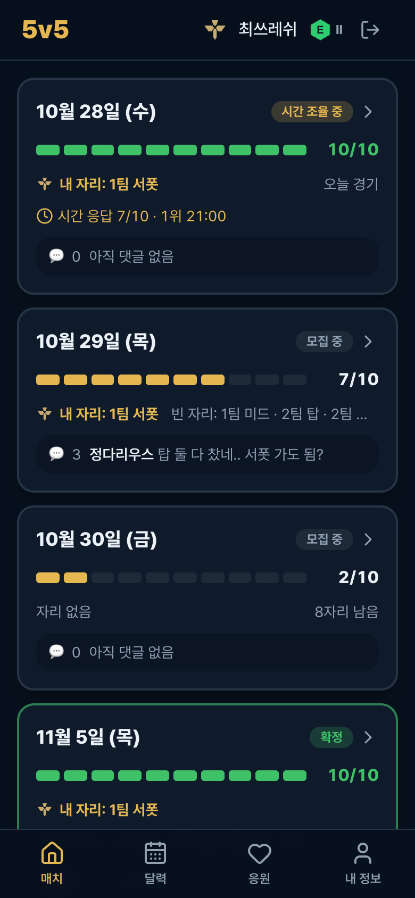 | 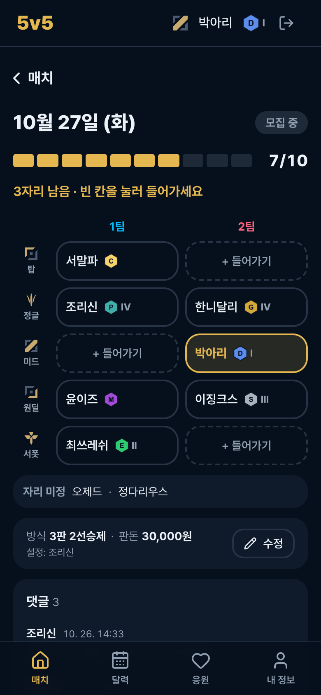 | 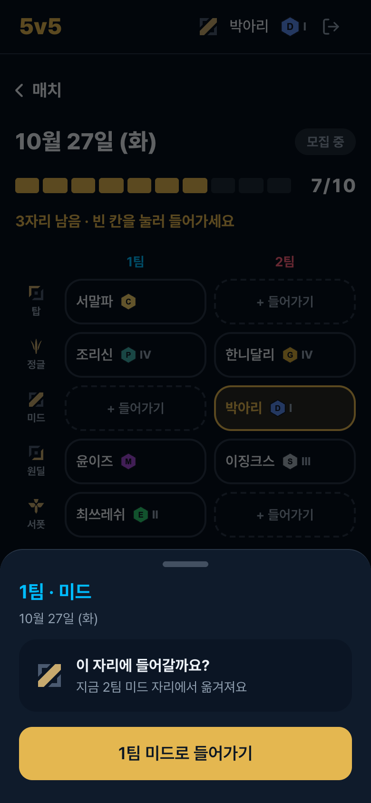 | 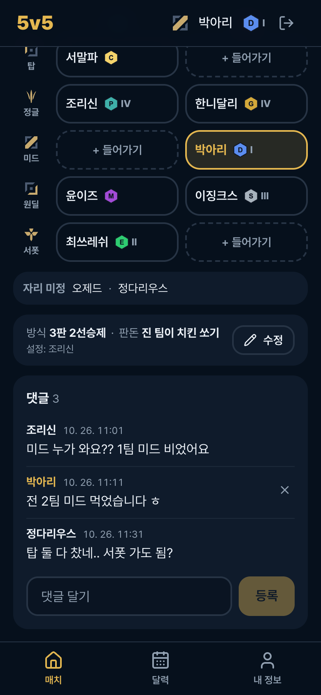 |
| **달력 참여/불참** | **매치 종료 (관리자)** | **MVP · 범인 투표** | **이전 매치** |
| 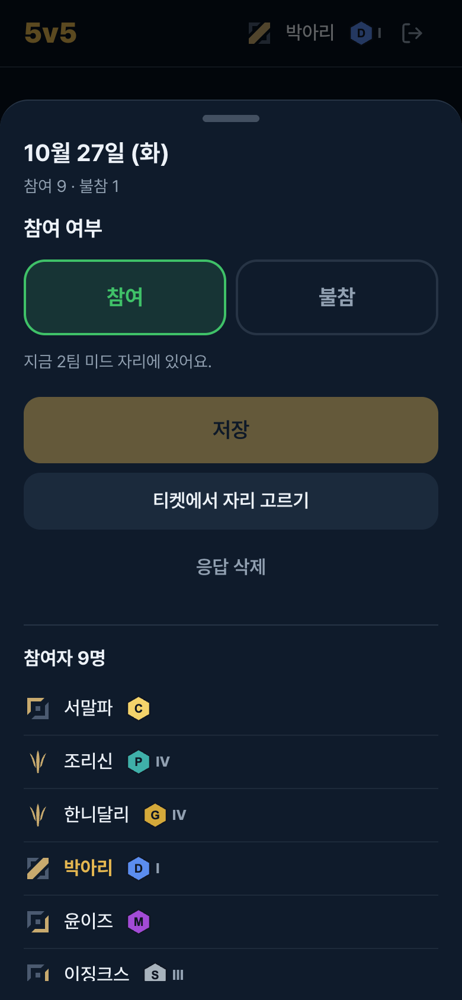 | 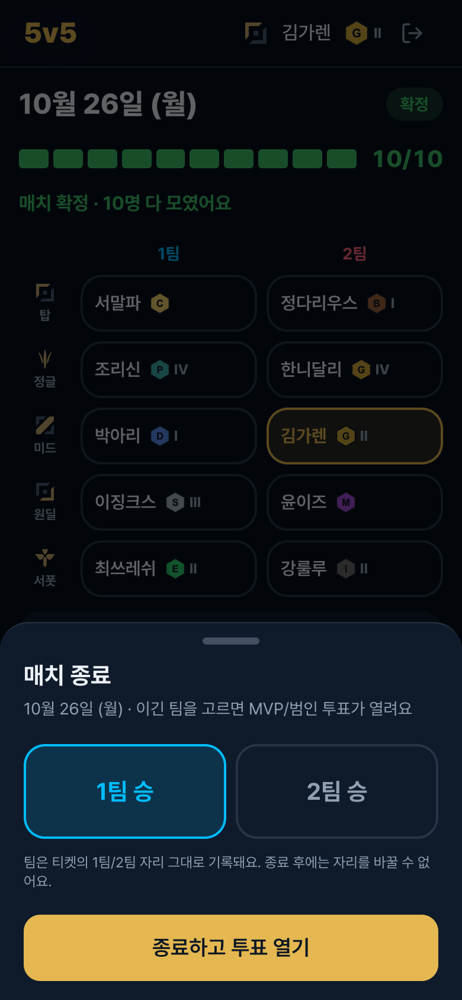 | 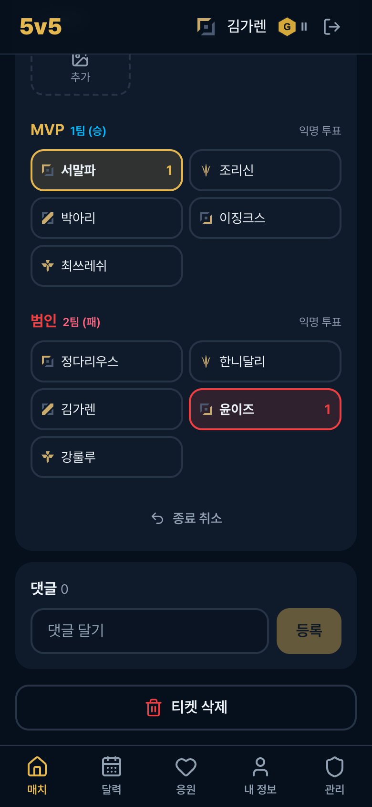 | 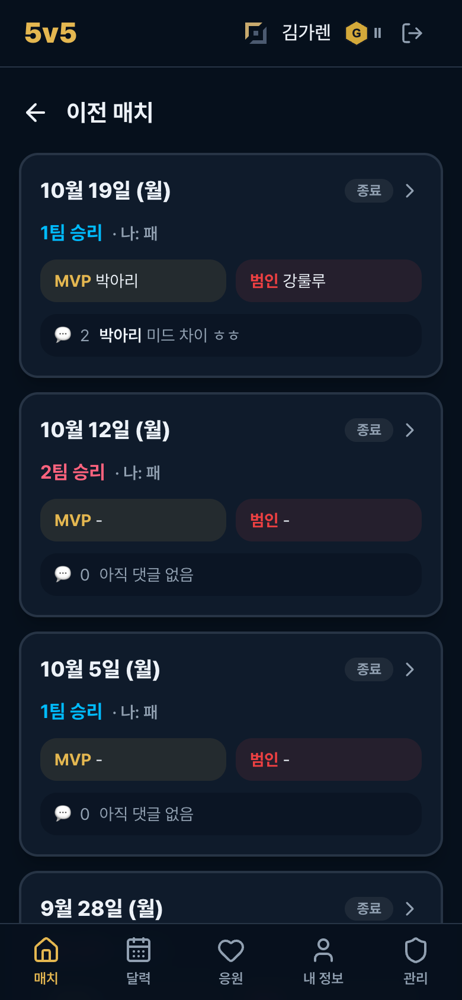 |
| **응원하기 (멤버 목록)** | **개인 페이지** | **세팅 (판돈·PC방)** | **익명 응원** |
| 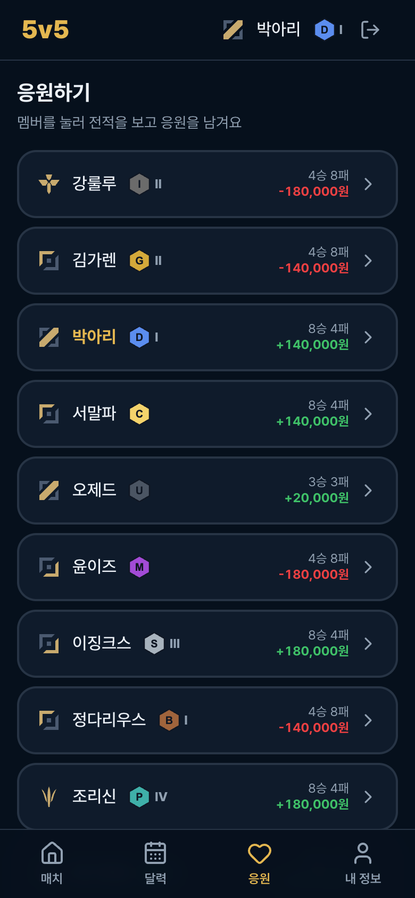 | 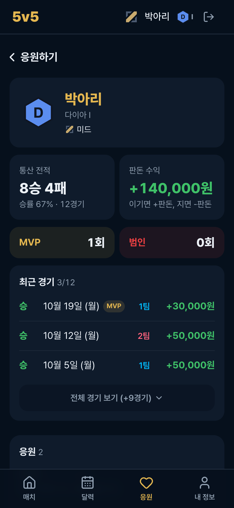 | 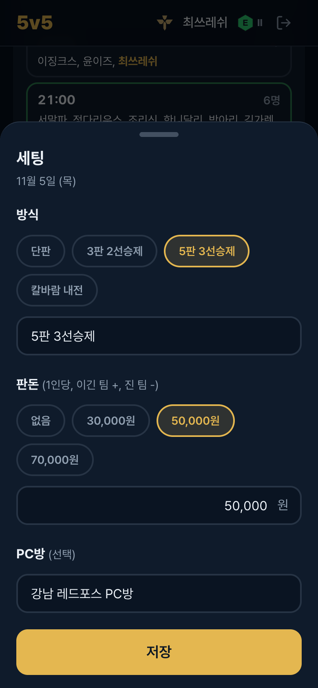 | 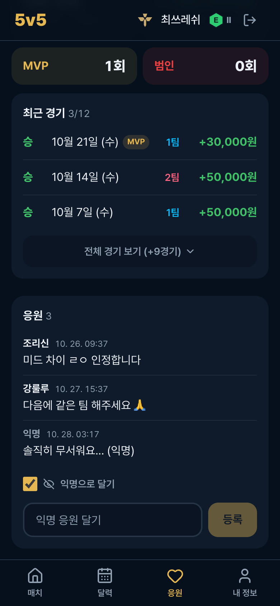 |
| **시작 시간 조율** | **시간 확정 · 캘린더** | | |
| 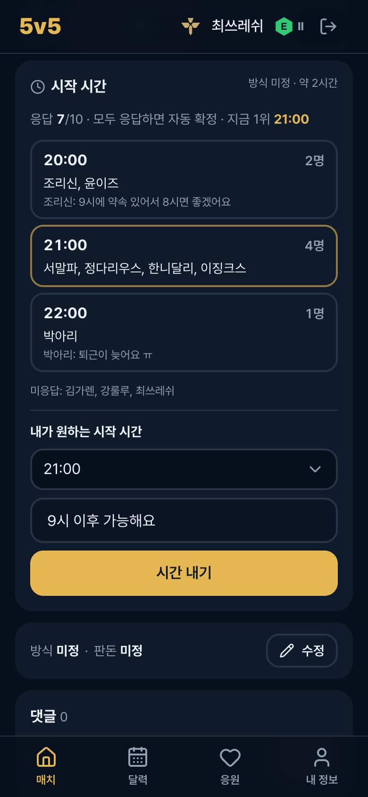 | 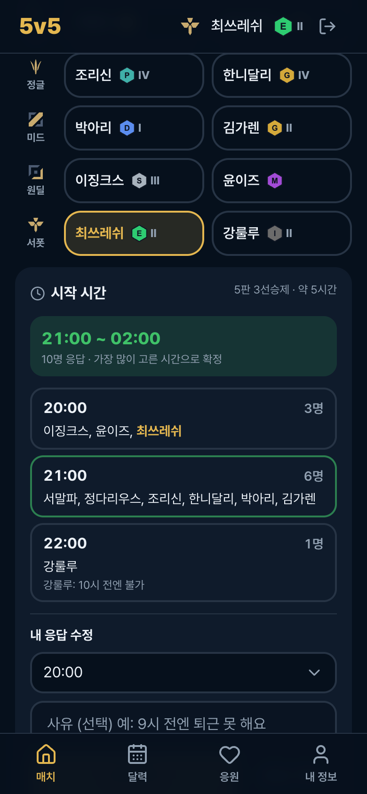 | | |

**공유 썸네일 (카톡/메시지 미리보기)**

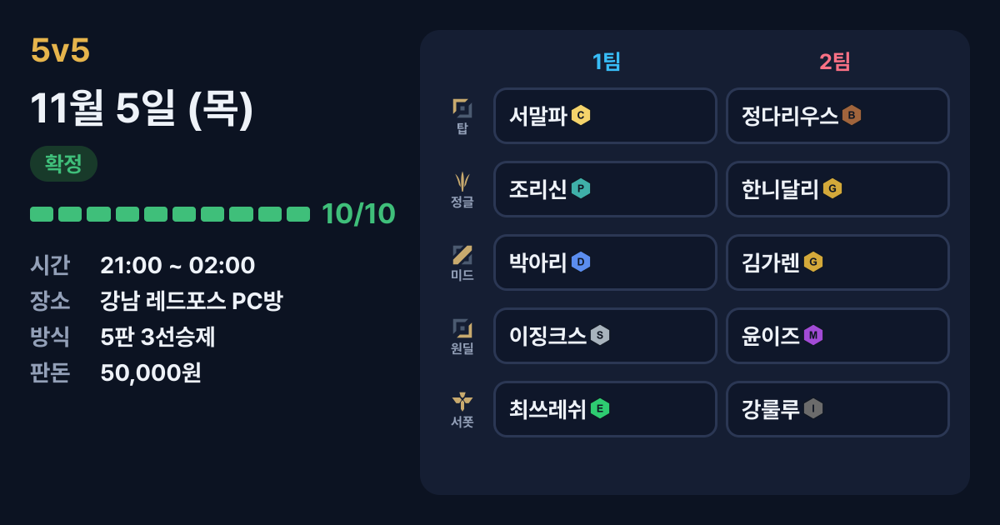

## 이렇게 씁니다

1. **관리자가 계정 생성** → 친구는 닉네임 선택 + PIN `0000`으로 첫 로그인 → 새 PIN 설정
2. **달력**에서 되는 날 **참여** → 그날 **티켓**이 생김
3. 티켓의 **1팀/2팀 × 탑·정글·미드·원딜·서폿 10칸** 중 빈 칸을 눌러 내 자리 잡기 (조율은 **댓글**로)
4. 10칸이 다 차면 각자 **원하는 시작 시간(+사유)**을 내고, 10명 모두 내면 **시간 자동 확정** → **내 캘린더에 추가**
5. 경기 후 관리자가 **승리팀**을 골라 종료
6. 경기한 10명이 **MVP(이긴 팀)**·**범인(진 팀)** 투표, 결과 스크린샷 공유
7. **응원** 탭에서 멤버별 **통산 전적·판돈 수익·MVP/범인 횟수**를 보고 응원 남기기

## 기능

### 계정
- **계정 생성:** 관리자만 할 수 있습니다(관리 탭 → 멤버 추가). 초기 PIN은 `0000`이고, 첫 로그인 때 새 PIN을 정해야 다른 화면을 쓸 수 있습니다.
- **첫 관리자:** 멤버가 0명일 때만 로그인 화면에서 직접 가입할 수 있고, 그 사람이 관리자가 됩니다.
- **로그인:** 닉네임 선택 → 4자리 PIN. 5번 틀리면 5분 잠금, 로그인은 30일 유지됩니다.
- **공유 링크 복귀:** 로그인 전에 티켓 링크로 들어오면 로그인 후 그 화면으로 돌아갑니다.
- **프로필(내 정보):** 티어 + 디비전(I~IV, 마스터 이상·언랭은 없음), 가능 라인(중복 선택), PIN 변경

### 달력
- 날짜를 누르면 그날 **참여 / 불참**을 저장합니다. 불참하면 티켓 자리도 비워집니다.
- 날짜 색: 티켓 있음 / 10자리 확정. 내가 자리 잡은 날엔 라인 아이콘, 불참한 날엔 빨간 점이 보입니다.
- 시트의 **티켓에서 자리 고르기**로 그날 티켓으로 바로 이동합니다.

### 티켓
- 그날 **참여자가 1명이라도 있으면** 생깁니다.
- **메인:** 오늘 이후 티켓을 요약 카드로 보여줍니다(게이지, 내 자리, 빈 자리, 최신 댓글). 누르면 상세로 갑니다.
- **상세(`/ticket/날짜`):** 링크로 단톡방에 공유할 수 있습니다.
  - **공유 버튼:** 폰에서는 기본 공유 팝업(링크 복사·카카오톡·메시지 등)이 뜨고, PC에서는 링크가 복사됩니다.
  - **썸네일:** 카톡·메시지에 붙이면 그 티켓 화면(날짜·상태·시간·PC방·10칸 자리표)이 미리보기 이미지로 보입니다. 자리나 시간이 바뀐 뒤 다시 공유하면 새 이미지가 나옵니다.
  - **자리 10칸:** 빈 칸을 누르면 참여 + 자리 확정, 다른 칸이면 이동, 내 칸을 누르면 자리 비우기
  - 한 칸에 한 명만 들어갈 수 있고, 동시에 누르면 먼저 저장된 사람이 들어갑니다.
  - 칸을 아직 안 고른 참여자는 **자리 미정**으로 보입니다(10칸이 다 차면 대기).
  - **방식·판돈:** 누구나 수정할 수 있고, 마지막 수정자가 표시됩니다. 지난/종료된 매치는 관리자만 수정할 수 있습니다.
  - **PC방:** 세팅에서 어느 PC방에서 할지 적습니다. 누르면 네이버 지도 검색으로 열립니다.
  - **판돈:** 1인당 금액(원)입니다. **없음 / 30,000 / 50,000 / 70,000원** 중에서 고르거나 숫자로 직접 입력합니다(최대 1,000,000원).
  - **댓글:** 티켓이 생길 때부터 누구나 쓸 수 있습니다(300자). 삭제는 작성자나 관리자만 할 수 있고, 작성자 이름을 누르면 그 사람의 개인 페이지로 갑니다.
- 상태: **모집 중**(10칸 미만) → **시간 조율 중**(10칸, 시간 미확정) → **확정**(시간까지 확정) → **종료**

### 시작 시간 조율
- 자리에 들어간 사람은 티켓 상세의 **시작 시간**에서 원하는 시작 시간(30분 단위, 10:00~다음날 02:00)과 **사유(선택)**를 냅니다. 언제든 수정·삭제할 수 있습니다.
- 시간별로 누가 골랐는지와 사유, 아직 안 낸 사람이 보입니다.
- **10칸이 다 차고 10명 모두 내면 자동 확정:** 가장 많이 고른 시간, 동률이면 늦은 시간입니다. 자리가 바뀌면 다시 계산됩니다.
- 경기 시간은 방식으로 잡습니다: 5판 3선승제 5시간, 3판 2선승제 3시간, 단판·칼바람 1시간, 그 외 2시간 (예: 21:00 ~ 24:00).
- 관리자는 시간을 직접 정하거나 자동으로 되돌릴 수 있습니다.
- 시간이 확정되지 않아도 경기 종료(승리팀 선택)는 할 수 있습니다.
- **캘린더에 추가:** 시간이 확정되면 자리에 있는 10명에게 **캘린더에 추가**(아이폰·안드로이드 기본 캘린더, .ics)와 **구글 캘린더** 버튼이 보입니다. 일정에는 내 팀·라인, 시간, PC방, 티켓 링크가 들어가고 1시간 전 알림이 설정됩니다.

### 매치 종료와 결과
- **종료(관리자):** 10칸이 다 차고 경기 당일부터 **종료 · 승리팀 선택** → 그 시점의 자리가 그대로 팀으로 기록됩니다.
- 종료된 매치는 자리와 참여를 바꿀 수 없습니다(관리자 포함). 고치려면 **종료 취소** 후 수정합니다.
- **투표:** 경기한 10명만, 본인 제외, 종류별 1표(다시 누르면 취소)
  - MVP는 이긴 팀에서, 범인은 진 팀에서 고르고, 화면에는 득표수만 보입니다.
- **스크린샷:** 매치당 10장까지 올릴 수 있습니다. 업로드할 때 자동으로 압축하고, 로그인한 멤버만 볼 수 있습니다.
- **이전 매치:** 메인 하단 **이전 매치 보기** → 승리팀, 나의 승패, MVP·범인 요약

### 응원하기
- **응원 탭:** 전체 멤버 목록에 각자 **N승 N패와 판돈 수익(+/−)**이 보입니다. 누르면 개인 페이지로 갑니다.
- **개인 페이지(`/players/ID`):**
  - **통산 전적**(승률, 경기 수)과 **판돈 수익**: 이긴 경기는 +판돈, 진 경기는 −판돈. 판돈이 미정인 경기는 빼고 계산합니다.
  - **MVP / 범인 횟수:** 그 경기에서 가장 많은 표를 받은 횟수입니다(동점이면 모두 인정, 표가 없는 경기는 제외).
  - **경기 기록:** 최근 3경기가 보이고, 더 있으면 **전체 경기 보기**로 펼칩니다. 그 경기에서 MVP나 범인이었으면 표시가 붙고, 누르면 그 티켓으로 갑니다.
  - **응원:** 동작은 티켓 댓글과 같습니다(누구나 작성, 작성자/관리자 삭제).
  - **익명 응원:** "익명으로 달기"를 체크하면 다른 멤버에게는 **익명**으로 보입니다. 내 글은 **익명 (나)**, 관리자에게는 **익명 (실명)**으로 보입니다. 실명은 관리자 화면에만 전달됩니다.
- **내 정보 → 내 전적 · 받은 응원 보기**로 내 페이지에 바로 갈 수 있습니다.

### 관리자
- 멤버 추가 / 정보·관리자 권한 수정 / **PIN 초기화(0000으로)** / 삭제
- 티켓 빈 칸에 다른 멤버 넣기, 다른 멤버 빼기, 달력에서 대신 참여/불참 등록
- 매치 종료 / 종료 취소 / 티켓 삭제(그날의 자리·댓글·투표·사진 전부 삭제)
- 지난/종료된 매치의 방식·판돈 수정 (판돈을 바꾸면 수익도 다시 계산)
- 시작 시간 직접 정하기 / 자동으로 되돌리기
- 익명 응원의 실제 작성자 확인

### 사용감
- 모든 버튼과 링크는 누르는 순간 살짝 줄어들고 흐려집니다(아이폰 포함).
- 화면을 이동할 때 맨 위에 금색 진행 바가 바로 떠서 눌렸는지 알 수 있습니다.

## 바로 실행 (DB 없이)

```bash
npm install
npm run dev:mock     # http://localhost:3000
```

- 가짜 멤버 11명이 들어 있고 **모든 PIN은 `0000`**, 관리자는 `김가렌`입니다.
- `오제드`로 로그인하면 첫 로그인 PIN 재설정 화면을 볼 수 있습니다.
- 지난 12주치 경기 결과가 있어서 **응원** 탭에서 전적·수익·MVP/범인 횟수를 볼 수 있습니다.
- **오늘 티켓**은 시간 응답 7/10(조율 중)이라 김가렌·강룰루·최쓰레쉬로 응답하면 자동 확정을 볼 수 있고, **+8일 티켓**은 이미 확정(캘린더 버튼)입니다.
- **오늘 티켓**은 10칸이 다 차 있어 종료와 투표를, **내일 티켓**은 빈 칸이 있어 자리 잡기와 댓글을 해볼 수 있습니다. 지난주 결과는 이전 매치에 있습니다.
- 데이터는 메모리에만 있어서 서버를 재시작하면 처음 상태로 돌아갑니다. 배포 환경에서는 자동으로 꺼집니다.

## 배포

Vercel에 저장소를 연결하고, Vercel 안에서 **Neon(DB)**과 **Blob(스크린샷)**을 만들어 붙인 뒤 `db/schema.sql`을 실행하면 됩니다. 모두 무료 플랜으로 충분하고, 오래 안 써도 멈추지 않습니다.

- 순서: [docs/DEPLOY.md](docs/DEPLOY.md) (가입부터 동작 확인, 친구 공유까지)
- 운영할 때 신경 쓸 것: [docs/NOTES.md](docs/NOTES.md) (무료 플랜 한도, 스키마 변경, 보안)

| 환경변수 | 설명 |
| --- | --- |
| `DATABASE_URL` | Neon 연결 문자열 (Neon 연결 시 자동) |
| `BLOB_READ_WRITE_TOKEN` | Vercel Blob 토큰 (Blob 연결 시 자동) |
| `SESSION_SECRET` | `openssl rand -base64 32` |

## 스택

Next.js 16 (App Router, Server Actions), React 19, Tailwind CSS v4, shadcn/ui, Neon (Postgres), Vercel Blob, Vercel

## 구조

```
src/
├── app/
│   ├── login/              # 닉네임 + PIN, 첫 관리자 가입
│   ├── change-pin/         # 첫 로그인 PIN 재설정
│   ├── (app)/              # 로그인 필요
│   │   ├── page.tsx        #   메인: 티켓 요약 목록
│   │   ├── ticket/[date]/  #   티켓 상세
│   │   ├── history/        #   이전 매치
│   │   ├── players/        #   응원하기 (멤버 목록, 개인 페이지)
│   │   ├── calendar/       #   달력
│   │   ├── profile/        #   내 정보
│   │   └── admin/          #   관리 (멤버)
│   ├── api/screenshots/    # 비공개 스크린샷 보기 (로그인 확인)
│   ├── api/calendar/       # 확정된 매치 .ics (캘린더에 추가)
│   ├── og/ticket/          # 공유 썸네일 이미지 (로그인 없이 공개)
│   └── actions/            # Server Actions (쓰기 + 권한 체크)
├── components/
│   ├── match/              # 티켓 요약/상세, 자리표, 댓글, 종료, 결과
│   ├── players/            # 경기 기록, 응원
│   ├── thread/             # 댓글/응원 공용 목록
│   ├── calendar/           # 달력, 참여 시트
│   └── icons/              # [라인] 닉네임 [티어] 표시
├── lib/
│   ├── repo/               # DB 접근 (postgres.ts = Neon, memory.ts = 목업)
│   └── ...                 # 세션, PIN 해시, 스크린샷 저장소, 상수
└── proxy.ts                # 로그인 후 원래 경로로 복귀
db/schema.sql               # DB 스키마 (처음 설치용, 재실행 안전)
db/migrations/              # 운영 중인 DB 업데이트용 SQL (배포 전에 실행)
public/icons/               # 라인/티어 아이콘 (같은 파일명으로 교체 가능, 교체 후 npm run icons)
```

## 보안 메모

- 브라우저는 DB에 직접 접근하지 않습니다. 모든 읽기와 쓰기는 서버에서 처리하고, 권한도 서버에서 확인합니다.
- PIN은 scrypt로 해시해서 저장합니다. 새 계정과 초기화된 계정은 첫 로그인 전까지 `0000`이니, 만들고 나면 바로 로그인하라고 알려 주세요.
- 계정은 관리자만 만들 수 있어서 링크가 퍼져도 모르는 사람이 가입할 수 없습니다.
- **공유 썸네일은 공개 이미지입니다.** 티켓 링크를 받은 사람은 로그인 없이도 썸네일 속 닉네임·티어·시간·PC방을 볼 수 있습니다(미리보기 봇이 로그인을 못 하기 때문). 티켓 화면 자체는 로그인해야 열립니다.
- 스크린샷은 비공개 Blob에 저장하고, 로그인한 멤버에게만 보여줍니다.
- 투표는 화면에서만 익명입니다. DB에는 누가 누구에게 투표했는지 저장됩니다.
