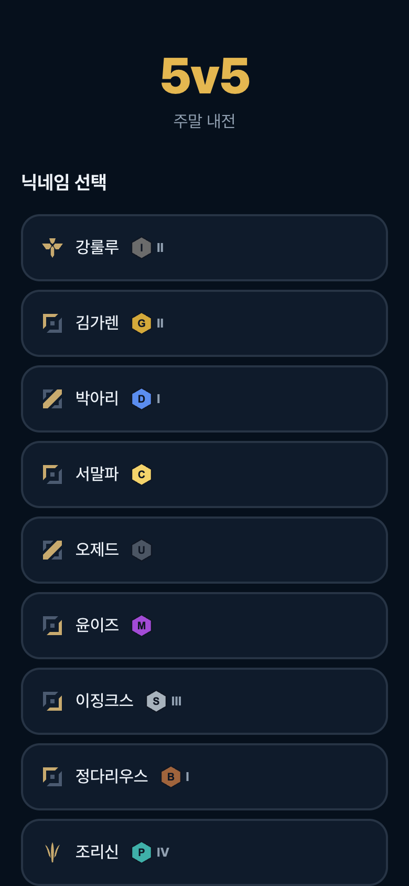
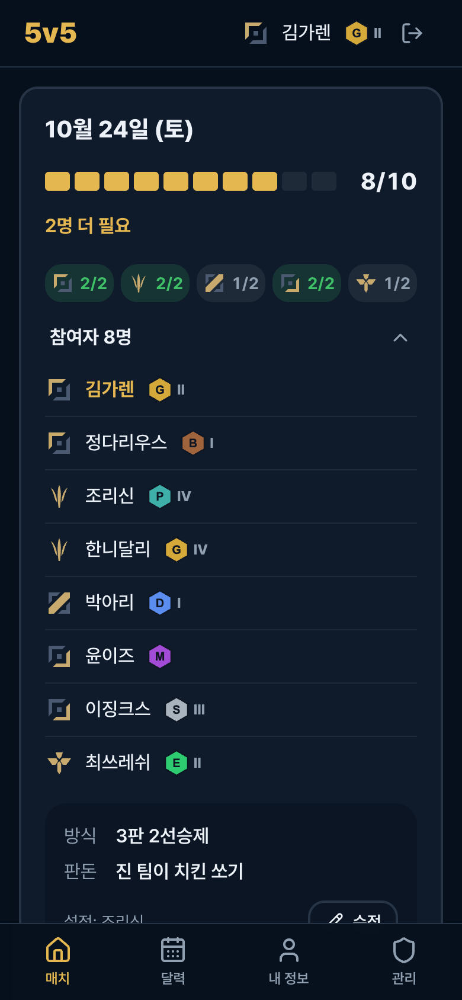
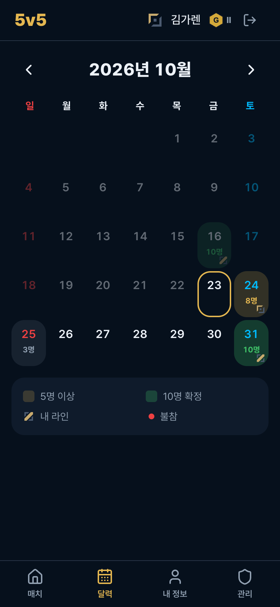
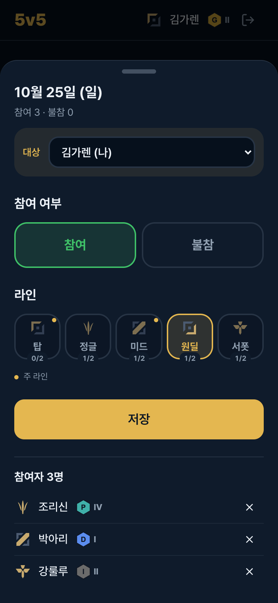

# 5v5

주말 롤 5대5 내전 일정을 잡는 모바일 웹앱.

| 로그인 | 매치 | 달력 | 일정 등록 |
| :---: | :---: | :---: | :---: |
|  |  |  |  |

## 기능

- **로그인**: 닉네임을 선택하고 4자리 PIN을 입력합니다. 첫 가입자가 관리자가 됩니다.
- **프로필**: 티어와 디비전(I~IV)을 고르고, 가능한 라인은 여러 개 선택할 수 있습니다.
- **달력**: 날짜를 누르면 참여 또는 불참과 라인 1개를 등록합니다.
- **매치 카드**: 5명 이상 모인 날에 생깁니다. N/10 게이지와 라인별 인원이 보이고, 방식과 판돈은 누구나 수정할 수 있습니다.
- **이전 매치**: 지난 매치는 메인 하단의 `이전 매치 보기`에서 볼 수 있습니다.
- **관리자**: 멤버, 일정, 카드를 모두 수정하거나 삭제할 수 있습니다.

## 바로 실행 (DB 없이)

```bash
npm install
npm run dev:mock
```

http://localhost:3000 에 접속해서 아무 닉네임이나 고르고 PIN `0000`을 입력하세요. 관리자 계정은 `김가렌`입니다.
데이터는 메모리에만 있어서 서버를 재시작하면 초기화됩니다.

## 배포

Supabase에 `supabase/schema.sql`을 실행하고, Vercel에 환경변수 3개를 넣으면 됩니다.
자세한 순서는 [docs/DEPLOY.md](docs/DEPLOY.md)에 있습니다.

| 환경변수 | 설명 |
| --- | --- |
| `SUPABASE_URL` | Supabase 프로젝트 URL |
| `SUPABASE_SERVICE_ROLE_KEY` | service_role 키 (서버 전용) |
| `SESSION_SECRET` | `openssl rand -base64 32` |

## 스택

Next.js 16 (App Router, Server Actions), React 19, Tailwind CSS v4, shadcn/ui, Supabase, Vercel

## 구조

```
src/
├── app/
│   ├── login/            # 닉네임 + PIN
│   ├── (app)/            # 로그인 필요: 매치(/), 이전 매치, 달력, 프로필, 관리
│   └── actions/          # Server Actions (쓰기 + 권한 체크)
├── components/
│   ├── match/            # 매치 카드, 게이지, 세팅 시트
│   ├── calendar/         # 달력, 일정 등록 바텀 시트
│   └── icons/            # [라인] 닉네임 [티어] 표시
├── lib/                  # DB, 세션, PIN 해시, 상수, 목업 DB
└── proxy.ts              # 로그인 후 원래 경로로 복귀
supabase/schema.sql       # DB 스키마
public/icons/             # 라인/티어 아이콘 (같은 파일명으로 교체 가능)
```

## 보안 메모

- 브라우저는 DB에 직접 접근하지 않습니다. 모든 데이터는 서버에서 service_role 키로 처리합니다.
- 모든 테이블에 RLS를 켜고 정책은 만들지 않았습니다. 그래서 anon 키로는 아무것도 읽을 수 없습니다.
- PIN은 scrypt로 해시해서 저장합니다. 5번 틀리면 5분 동안 잠깁니다.
- 가입 링크는 누구나 쓸 수 있습니다. 모르는 멤버가 생기면 관리 탭에서 삭제하세요.
