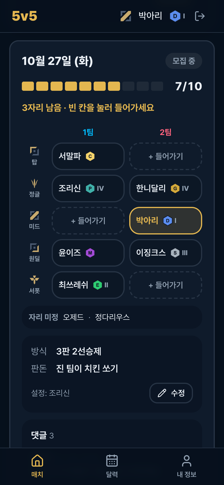
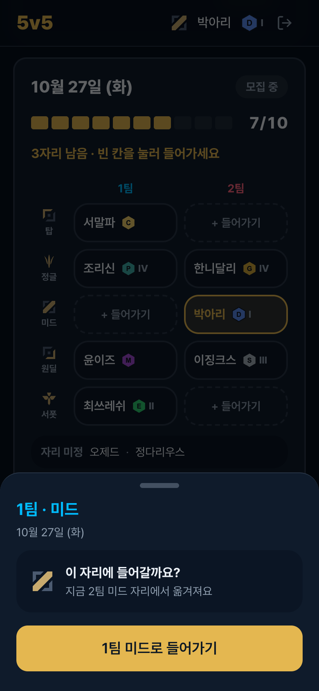
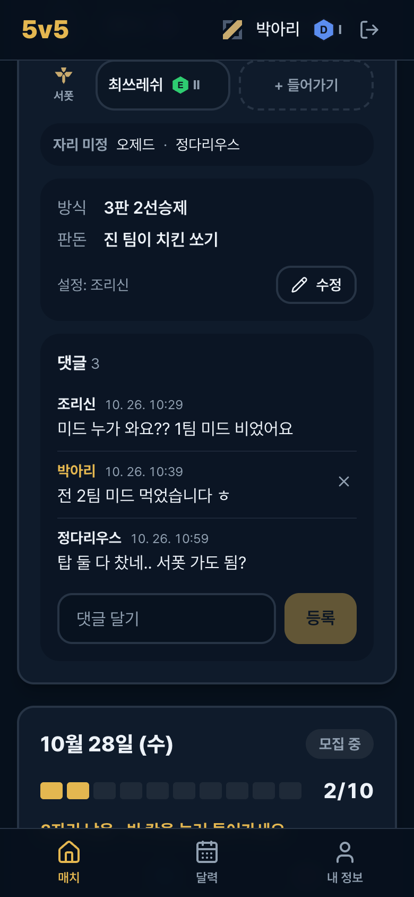
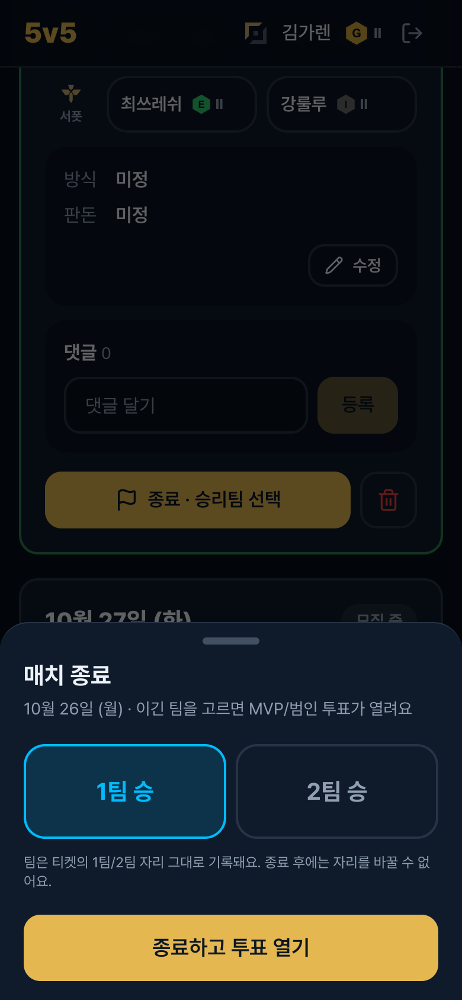
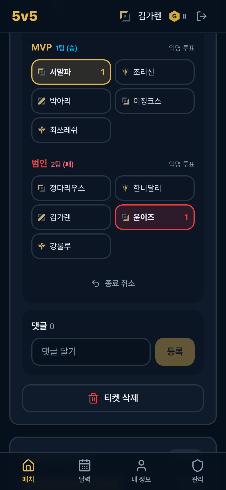

# 5v5

주말 롤 5대5 내전 일정을 잡는 모바일 웹앱.

| 티켓 (1팀/2팀 자리) | 빈 칸 들어가기 | 댓글로 조율 |
| :---: | :---: | :---: |
|  |  |  |
| **달력 참여/불참** | **매치 종료 (관리자)** | **MVP · 범인 투표** |
|  |  |  |

## 기능

- **계정**: 관리자만 계정을 만듭니다(초기 PIN `0000`, 첫 로그인 때 새 PIN 설정). 멤버가 0명일 때 처음 가입한 사람이 관리자가 됩니다.
- **로그인**: 닉네임을 선택하고 4자리 PIN을 입력합니다.
- **프로필**: 티어와 디비전(I~IV)을 고르고, 가능한 라인은 여러 개 선택할 수 있습니다.
- **달력**: 날짜를 누르면 그날 참여/불참을 등록합니다.
- **티켓**: 누군가 참여한 날마다 생깁니다. **1팀/2팀 × 탑·정글·미드·원딜·서폿 10칸**에 각자 빈 칸을 눌러 들어갑니다(참여 처리 포함, 다른 칸으로 이동 가능). 칸을 아직 안 고른 사람은 "자리 미정"에 보입니다.
- **댓글**: 티켓마다 댓글이 있어서 경기 전 자리 조율부터 경기 후 수다까지 할 수 있습니다.
- **세팅**: 방식과 판돈은 누구나 수정할 수 있고, 마지막 수정자가 표시됩니다.
- **매치 종료**: 10칸이 다 차면 확정되고, 경기 당일부터 관리자가 승리팀만 골라 종료합니다.
- **경기 결과**: 종료되면 이긴 팀에서 MVP, 진 팀에서 범인을 익명으로 투표하고, 결과 스크린샷을 올릴 수 있습니다.
- **이전 매치**: 지난 매치는 메인 하단의 `이전 매치 보기`에서 볼 수 있습니다.
- **관리자**: 멤버를 만들고 수정·삭제하며, 다른 멤버를 칸에 넣거나 뺄 수 있고, 티켓을 삭제할 수 있습니다.

## 바로 실행 (DB 없이)

```bash
npm install
npm run dev:mock
```

http://localhost:3000 에 접속해서 아무 닉네임이나 고르고 PIN `0000`을 입력하세요. 관리자 계정은 `김가렌`입니다.
`오제드`는 첫 로그인 PIN 재설정 흐름을 볼 수 있는 계정입니다.
오늘 티켓은 10칸이 다 차 있어 종료와 투표를, 내일 티켓은 빈 칸이 있어 자리 들어가기와 댓글을 해볼 수 있습니다.
데이터는 메모리에만 있어서 서버를 재시작하면 초기화됩니다.

## 배포

Vercel에 저장소를 연결하고, Vercel 안에서 Neon(DB)과 Blob(스크린샷)을 만들어 붙인 뒤 `db/schema.sql`을 실행하면 됩니다. 모두 무료 플랜으로 충분합니다.
자세한 순서는 [docs/DEPLOY.md](docs/DEPLOY.md)에 있습니다.
운영하면서 신경 쓸 것(무료 플랜 일시정지, 스키마 변경, 보안 등)은 [docs/NOTES.md](docs/NOTES.md)에 정리해 두었습니다.

| 환경변수 | 설명 |
| --- | --- |
| `DATABASE_URL` | Neon 연결 문자열 (Neon 연결 시 자동) |
| `BLOB_READ_WRITE_TOKEN` | Vercel Blob 토큰 (Blob 연결 시 자동) |
| `SESSION_SECRET` | `openssl rand -base64 32` |

## 스택

Next.js 16 (App Router, Server Actions), React 19, Tailwind CSS v4, shadcn/ui, Neon (Postgres), Vercel Blob, Vercel

## 구조

```
src/
├── app/
│   ├── login/            # 닉네임 + PIN
│   ├── (app)/            # 로그인 필요: 매치(/), 이전 매치, 달력, 프로필, 관리
│   └── actions/          # Server Actions (쓰기 + 권한 체크)
├── components/
│   ├── match/            # 매치 카드, 게이지, 세팅 시트, 결과(투표/스크린샷)
│   ├── calendar/         # 달력, 일정 등록 바텀 시트
│   └── icons/            # [라인] 닉네임 [티어] 표시
├── lib/
│   ├── repo/             # DB 접근 (postgres.ts = Neon, memory.ts = 목업)
│   └── ...               # 세션, PIN 해시, 스크린샷 저장소, 상수
└── proxy.ts              # 로그인 후 원래 경로로 복귀
db/schema.sql             # DB 스키마 (Postgres)
public/icons/             # 라인/티어 아이콘 (같은 파일명으로 교체 가능)
```

## 보안 메모

- 브라우저는 DB에 직접 접근하지 않습니다. 모든 읽기와 쓰기는 서버에서 처리하고, 권한도 서버에서 확인합니다.
- 스크린샷은 비공개 Blob에 저장하고, 로그인한 멤버에게만 보여줍니다.
- PIN은 scrypt로 해시해서 저장합니다. 5번 틀리면 5분 동안 잠깁니다.
- 가입 링크는 누구나 쓸 수 있습니다. 모르는 멤버가 생기면 관리 탭에서 삭제하세요.
